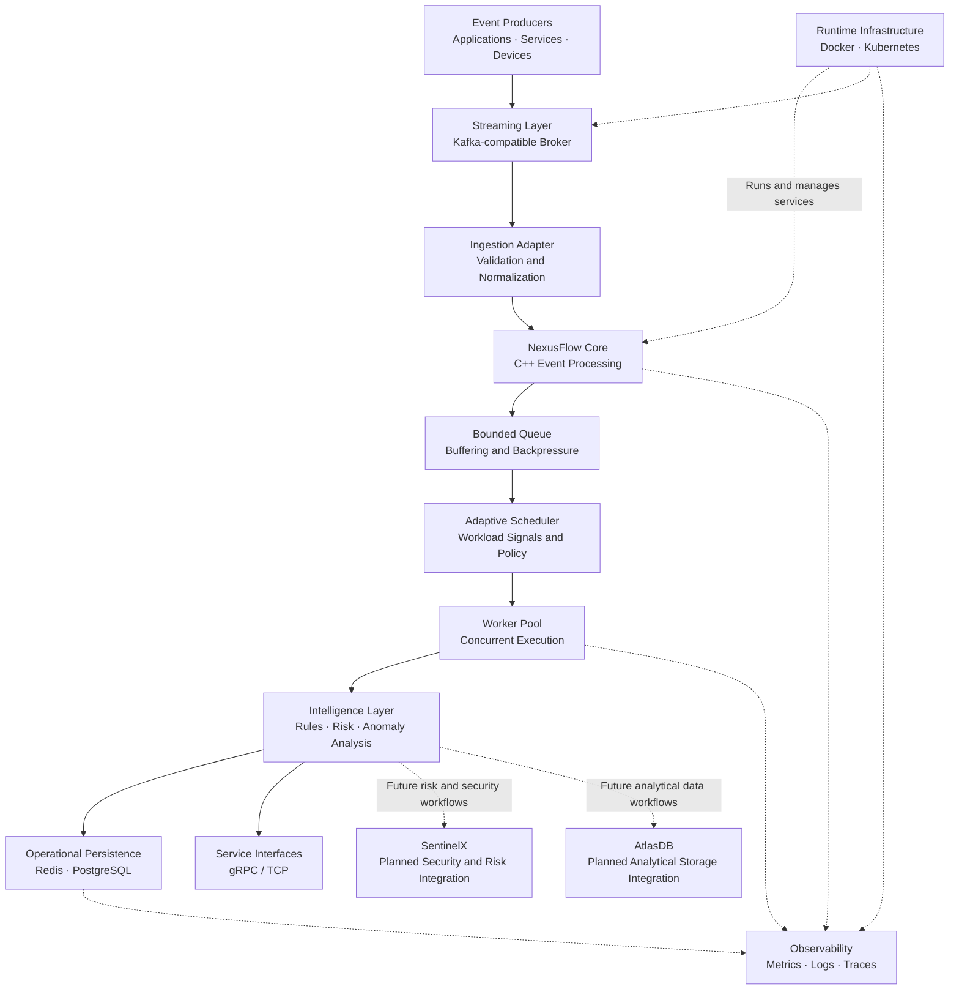
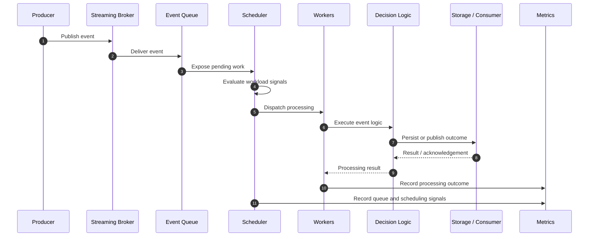
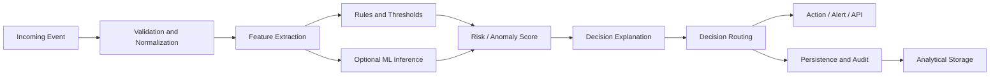

 <div align="center">

# NexusFlow

### Adaptive Real-Time Event Processing & Intelligent Decision Infrastructure

<p><strong>From high-throughput event ingestion to workload-aware processing, measurable performance, and intelligent decisions.</strong></p>

<p>
<a href="https://github.com/gavneet0030/NexusFlow"></a>
<a href="https://isocpp.org/"></a>
<a href="https://cmake.org/"></a>
<a href="https://www.docker.com/"></a>
<a href="https://kubernetes.io/"></a>
</p>

<p>
<a href="#-the-vision">Vision</a> ·
<a href="#-architecture">Architecture</a> ·
<a href="#-research-and-benchmarks">Benchmarks</a> ·
<a href="#-live-demo-and-video-showcase">Demo Videos</a> ·
<a href="#-getting-started">Getting Started</a> ·
<a href="#-roadmap">Roadmap</a>
</p>

**NexusFlow is a C++-based event-processing platform exploring how workload-aware scheduling, concurrent execution, queue management, and measurable performance can improve the engineering of real-time data systems.**

</div>

---

## Table of Contents

- [The Vision](#-the-vision)
- [The Problem](#-the-problem)
- [Project Goals](#-project-goals)
- [Architecture](#-architecture)
- [End-to-End Event Lifecycle](#-end-to-end-event-lifecycle)
- [Adaptive Scheduling Engine](#-adaptive-scheduling-engine)
- [Progressive Intelligence Architecture](#-progressive-intelligence-architecture)
- [Technology Stack](#-technology-stack)
- [Research and Benchmarks](#-research-and-benchmarks)
- [Real-World Data and Workload Design](#-real-world-data-and-workload-design)
- [Live Demo and Video Showcase](#-live-demo-and-video-showcase)
- [Reliability and Fault Tolerance](#-reliability-and-fault-tolerance)
- [Observability and Deployment](#-observability-and-deployment)
- [Industry Applications](#-industry-applications)
- [Project Structure](#-project-structure)
- [Getting Started](#-getting-started)
- [Testing and Validation](#-testing-and-validation)
- [Performance Engineering Methodology](#-performance-engineering-methodology)
- [Security](#-security)
- [Engineering Trade-offs and Current Limitations](#-engineering-trade-offs-and-current-limitations)
- [Roadmap](#-roadmap)
- [Release Readiness](#-release-readiness)
- [Contributing](#-contributing)
- [License](#-license)

---

## 🚀 The Vision

Modern digital systems continuously generate events: financial transactions, security alerts, retail orders, infrastructure telemetry, user activity, and industrial sensor readings.

The challenge is not simply to receive these events. A robust system must process them correctly, control queue growth, manage concurrency, respond to changing workloads, preserve important events, and provide measurable evidence of its behavior.

**NexusFlow aims to turn event processing into an observable, workload-aware, and experimentally verifiable engineering system.**

The long-term vision is to develop a platform that connects:

- High-performance C++ event processing.
- Adaptive scheduling and concurrent execution.
- Streaming ingestion and backpressure management.
- Rule-based and intelligent event analysis.
- Risk assessment and decision generation.
- Analytical persistence and downstream integration.
- Metrics, traces, and reproducible performance experiments.
- Containerized deployment and operational validation.

NexusFlow is being developed as a progressive engineering project. Its capabilities will be expanded and verified in stages rather than assuming that every designed integration is already complete.

### What makes the project interesting?

| Engineering dimension | Focus |
|---|---|
| Systems programming | C++ execution paths, worker lifecycle, queues, and resource management. |
| Performance engineering | Throughput, tail latency, queue waiting, saturation, and benchmark reproducibility. |
| Adaptive processing | Comparing processing modes using workload signals and scheduling policies. |
| Distributed systems | Streaming ingestion, service communication, persistence, and failure semantics. |
| Intelligent decisions | A future integration path for event analysis, risk scoring, and explainable outcomes. |
| Cloud-native engineering | Containers, Kubernetes resources, health checks, and operational observability. |
| Research discipline | Controlled experiments, event-integrity checks, and transparent reporting of limitations. |

---

## 🎯 The Problem

Fixed processing strategies can work well under predictable conditions. However, real workloads are often bursty, uneven, and time-sensitive.

### 1. Fixed execution strategies

A single-threaded pipeline is relatively straightforward, but it may leave processing capacity unused. Parallel execution can increase throughput, but introduces synchronization, coordination, and contention costs.

### 2. Queue saturation

When events arrive faster than the system can process them, queues grow. Waiting time increases, memory consumption rises, and overload can lead to delayed or rejected work.

### 3. Throughput is not the whole story

A system can report high throughput while delivering unacceptable P95 or P99 latency. Average latency alone can hide severe delays experienced by a portion of events.

### 4. Workload variability

Different workloads may benefit from different processing strategies. Event size, processing cost, arrival rate, queue depth, and event priority can all affect performance.

### 5. Correctness across the pipeline

Receiving a message does not prove that it was processed correctly or persisted successfully. Every stage needs explicit accounting and appropriate failure handling.

### The central engineering question

> Can a workload-aware processing architecture make more informed scheduling decisions than a fixed strategy while preserving event integrity and providing measurable evidence of its behavior?

NexusFlow investigates this question through implementation, controlled experiments, and iterative validation.

---

## 🧭 Project Goals

The project aims to:

- Build a modular event-processing engine using modern C++.
- Evaluate individual-event, micro-batch, and parallel execution modes.
- Explore workload-aware scheduling using queue depth, arrival rate, event priority, and latency budgets.
- Measure throughput, P50/P95/P99 latency, queue waiting time, and processing integrity.
- Investigate overload behavior, queue saturation, and backpressure.
- Integrate streaming infrastructure and service interfaces.
- Validate worker shutdown, event accounting, and recovery behavior.
- Explore intelligent event analysis and downstream decision systems.
- Develop reproducible performance experiments with documented methodology.
- Package and validate the system through containers and cloud-native deployment configurations.

The objective is not to claim that every technique is automatically superior. It is to implement, measure, compare, and improve the system based on evidence.

---

## 🏗️ Architecture

NexusFlow is organized around a C++ processing core, with supporting ingestion, scheduling, decision, storage, and operational components.

The following diagrams describe the **target system architecture**. They distinguish the intended end-to-end design from the individual integrations that still require verification.

### 1. High-level system architecture



### 2. Architecture layers

| Layer | Responsibility | Key engineering concerns |
|---|---|---|
| Event producers | Generate incoming events. | Event schemas, bursts, duplicate messages. |
| Streaming ingestion | Receive and deliver event messages. | Acknowledgements, retries, delivery semantics. |
| Processing core | Coordinate event execution. | Correctness, lifecycle management, concurrency. |
| Queue and backpressure | Buffer pending work. | Capacity, queue pressure, overload policy. |
| Adaptive scheduler | Select processing modes and dispatch work. | Scheduling overhead, fairness, policy stability. |
| Worker pool | Execute events. | Synchronization, utilization, shutdown. |
| Intelligence layer | Apply processing and decision logic. | Processing cost, decision quality, explainability. |
| Persistence | Store supported state and outputs. | Durability, consistency, retries, failure handling. |
| Service interfaces | Expose selected functionality. | API contracts, timeouts, availability. |
| Observability | Expose runtime behavior. | Metric accuracy, trace coverage, actionable alerts. |
| Deployment infrastructure | Run and manage services. | Security, resources, health, recovery. |

### 3. Event-processing lifecycle



This is the intended flow. A complete integration test must verify the actual path through the running system, including output validation and event accounting.

### 4. Architectural boundaries

The presence of a component, API, deployment manifest, or configuration file does not by itself prove that the complete system is integrated.

For example, successful ingestion, successful processing, and durable persistence are separate outcomes. End-to-end validation must verify each relevant boundary independently.

---

## ⚙️ Adaptive Scheduling Engine

A core research theme in NexusFlow is the evaluation of processing strategies under changing workload conditions.

### Processing modes

| Mode | Strategy | Potential advantage | Trade-off |
|---|---|---|---|
| `SINGLE` | Process events individually through a simpler execution path. | Lower coordination complexity and a useful baseline. | May not use available parallel capacity effectively. |
| `MICRO_BATCH` | Group multiple events before processing them. | May reduce repeated dispatch or coordination overhead. | Batch formation can increase waiting time. |
| `PARALLEL` | Distribute processing work across workers. | May increase throughput for suitable workloads. | Synchronization, contention, and scheduling add overhead. |

The current micro-batch concept should not be confused with vectorized execution or GPU-style batching. Any such capability would require a separate implementation and evaluation.

### Workload signals

The scheduling design considers:

- **Arrival rate:** how quickly new events enter the pipeline.
- **Queue depth:** how much work is waiting.
- **Event priority:** the relative importance of different events.
- **Remaining latency budget:** how much time remains before an event exceeds its target.
- **CPU utilization:** a signal of available processing capacity.
- **Worker capacity:** the resources available to execute queued work.

The quality of scheduling decisions depends on signal accuracy, sampling frequency, thresholds, workload characteristics, and the overhead introduced by the scheduler itself.

### Adaptive versus fixed scheduling

| Dimension | Fixed strategy | Adaptive strategy |
|---|---|---|
| Processing mode | Predetermined. | Selected using workload signals and policy. |
| Workload response | Limited without external reconfiguration. | Can respond to changing conditions when enabled and implemented. |
| Complexity | Simpler to reason about. | Requires tuning, observability, and transition validation. |
| Performance | Depends on workload fit. | Must be demonstrated through experiments. |
| Operational requirements | Fewer policy parameters. | Requires careful threshold and policy management. |

**Important:** Adaptive scheduling is a hypothesis to evaluate, not an automatic performance guarantee. A poor policy may perform worse than a fixed strategy because of noisy signals, unnecessary mode switching, or additional coordination costs.

---

## 🧠 Progressive Intelligence Architecture

NexusFlow's long-term direction extends beyond event transport and processing toward an integrated event-intelligence workflow.

This is a staged roadmap, not a claim that all planned integrations are already functional.

### Intended intelligent decision flow



### Planned integration direction

**NexusFlow → SentinelX**

The intended integration direction is to use processed events and relevant signals in a security, risk, or intelligent-analysis workflow. Exact APIs, event contracts, decision responsibilities, and integration behavior must be implemented and tested before claiming a working connection.

**NexusFlow → AtlasDB**

The intended integration direction is to deliver suitable event records, analytical outputs, or processing metadata into an analytical storage workflow. Schema design, write semantics, query behavior, and end-to-end persistence must be validated independently.

### Progressive implementation strategy

1. Establish correct event ingestion and processing.
2. Add deterministic rule-based decisions.
3. Define stable event and decision schemas.
4. Add risk scoring or anomaly-detection integration.
5. Introduce explainable decision outputs.
6. Integrate downstream services through explicit contracts.
7. Persist outcomes and validate event accounting.
8. Measure decision latency and throughput overhead.
9. Test recovery, retries, duplicate delivery, and partial failures.
10. Demonstrate the complete workflow through reproducible experiments and video.

This order reduces the risk of building sophisticated intelligence on top of an unverified processing foundation.

---

## 🧰 Technology Stack

The project uses or explores the following technologies. Actual runtime availability and integration completeness must be verified against the repository and test results.

| Technology | Role |
|---|---|
| C++20 | Core processing implementation. |
| CMake | Native build configuration. |
| Threads and worker pools | Concurrent execution and worker lifecycle. |
| Bounded queues | Work buffering and queue-pressure management. |
| Kafka-compatible streaming | Event ingestion and delivery. |
| Redpanda | Kafka-compatible broker for integration experiments. |
| gRPC / TCP | Service communication and networking. |
| Redis / PostgreSQL | State and persistence integrations. |
| Python | Experiment processing and benchmark analysis. |
| NumPy / Pandas / scikit-learn | Data analysis and potential intelligence workflows. |
| Docker | Containerization. |
| Docker Compose | Multi-service local environment definitions. |
| Kubernetes | Deployment, service, health-check, and scaling configuration. |
| Prometheus / Grafana | Intended metrics collection and visualization. |
| OpenTelemetry / Tempo | Intended tracing and observability integration. |
| CTest and integration tests | Native test execution and component validation. |

---

## 📊 Research and Benchmarks

Performance evaluation is a central part of NexusFlow. Historical experiments have examined saturation behavior, scheduler comparisons, and end-to-end latency.

**The figures below are historical reported measurements, not a freshly reproduced benchmark suite or a production service-level guarantee.**

### Experiment 1 — Saturation sweep

<details open>
<summary><strong>Configuration and results</strong></summary>

| Parameter | Reported result |
|---|---:|
| Total runs | 27 |
| Events per run | 10,000 |
| Total event workload | 270,000 |
| Offered-load levels | 9 |
| Repetitions per load level | 3 |
| Reported offered-load range | 10,000–50,000 events/s |
| Event-integrity validation | 27/27 runs passed |
| Estimated saturation knee | Approximately 20,000 offered events/s |
| Recommended operating point in the experiment | Approximately 30,000 offered events/s |
| Highest measured mean throughput | 32,759.22 events/s |

**Interpretation:** The measurements suggest that throughput does not necessarily grow proportionally with offered load. The recommended operating point is specific to the tested configuration, workload, and environment. It must be re-evaluated after changes to the processing pipeline or execution environment.

</details>

### Experiment 2 — Scheduler comparison

<details>
<summary><strong>Comparison design and statistical limitations</strong></summary>

The historical comparison used:

- Four processing modes or configurations.
- Five offered-load levels.
- Three repetitions per configuration.
- 10,000 events per run.
- 60 total runs.
- A reported event-integrity pass rate of 100%.

The recorded analysis reported **zero statistically significant throughput comparisons out of 15 tested comparisons**.

This does not prove that the scheduling modes are equivalent. Three repetitions per configuration provide limited statistical power. Additional independent runs, confidence intervals, effect sizes, and controlled machine conditions are required for stronger conclusions.

</details>

### Experiment 3 — End-to-end latency

<details>
<summary><strong>Dataset, workload, and reported measurements</strong></summary>

The historical experiment used the UCI Online Retail II dataset.

| Parameter | Reported configuration |
|---|---|
| Events per run | 10,000 |
| Offered loads | 1,000; 10,000; 20,000; 30,000; 50,000 events/s |
| Repetitions per load | 3 |
| Total runs | 15 |
| Dataset | UCI Online Retail II |

At an offered load of 50,000 events/s, the report recorded:

| Metric | Historical reported result |
|---|---:|
| Achieved throughput | 22,525.33 events/s |
| End-to-end P50 latency | 72,485.8 µs |
| End-to-end P99 latency | 127,703 µs |
| Queue-wait fraction | 99.9712% |

**Interpretation:** Queue waiting dominated end-to-end latency at the highest tested offered load in that experiment. Achieved throughput was below the offered rate, which is consistent with overload relative to the tested processing capacity.

These figures are diagnostic evidence for that experiment, not a universal capacity limit. The original environment, measurement implementation, event-processing path, and raw artifacts should be reviewed before attempting to reproduce the conclusions.

</details>

### What the experiments teach us

- Offered load and achieved throughput are different metrics.
- Queue waiting can dominate latency near saturation.
- P99 latency can reveal problems hidden by averages.
- Event-integrity validation is separate from performance evaluation.
- Small sample sizes can make scheduler comparisons inconclusive.
- Every benchmark should be tied to a documented environment and version.

### Benchmark evidence to publish

For stronger reproducibility, benchmark reports should include:

- Hardware and operating system.
- Compiler, build configuration, and repository commit.
- Workload parameters and event payload characteristics.
- Warm-up policy, run duration, and repetitions.
- Offered load and achieved throughput.
- P50, P95, P99, and where useful P99.9 latency.
- Queue waiting and processing time.
- Accepted, processed, failed, rejected, and persisted event counts.
- Statistical analysis and uncertainty.
- Raw measurements, analysis scripts, and artifact checksums.

A future release should link the exact benchmark reports and artifacts used to produce its headline metrics.

---

## 🧪 Real-World Data and Workload Design

### UCI Online Retail II

The historical end-to-end latency experiment used the **Online Retail II** dataset from the UCI Machine Learning Repository.

Dataset: [UCI Machine Learning Repository — Online Retail II](https://archive.ics.uci.edu/dataset/502/online+retail+ii)

The dataset contains historical retail transactions that can support event-oriented workloads involving transaction records, quantities, prices, customer information, and timestamps.

Historical records are not inherently a live event stream. Any replay or transformation into events should be documented, including the transformation logic and the distinction between original data and generated workload.

### Synthetic workload generation

Synthetic workloads can be used to control:

- Arrival rate and burstiness.
- Event payload size.
- Priority distribution.
- Processing-cost variation.
- Duplicate and malformed inputs.
- Queue pressure and overload.
- Recovery scenarios.

Synthetic data is useful for isolating system behavior, but it should not be presented as equivalent to real production traffic.

### Event-integrity model

A meaningful test should distinguish:

- Events submitted.
- Events accepted.
- Events enqueued.
- Events successfully processed.
- Events rejected or failed.
- Events persisted or delivered to downstream consumers.

The exact invariant depends on retry and delivery semantics. Intentional rejection, duplicate delivery, and retry behavior must be accounted for explicitly.

---

## 🎬 Live Demo and Video Showcase

The final project should be demonstrated through short, focused videos that show **the actual system running**, rather than relying only on diagrams or screenshots.

This section is intentionally included now so that the finished project can be documented without redesigning the README later.

### Demo gallery

<div align="center">

| Demo | What the video will show | Status |
|---|---|---|
| **01 — Project Overview** | The architecture, problem statement, and complete event-processing journey. | Planned |
| **02 — Live Event Processing** | Events entering the system, processing activity, output, and event accounting. | Planned |
| **03 — Adaptive Scheduling** | Workload changes, processing-mode behavior, queue pressure, and observed performance. | Planned |
| **04 — Benchmark Laboratory** | Benchmark execution, throughput, P50/P99 latency, and experiment analysis. | Planned |
| **05 — Failure and Recovery** | A controlled failure, the observed system response, and recovery validation. | Planned |
| **06 — Containerized Deployment** | The verified Docker or Kubernetes deployment and its health behavior. | Planned |
| **07 — Intelligent Decision Workflow** | The completed event-analysis, risk, explanation, and persistence workflow. | Planned |
| **08 — End-to-End Project Demo** | A complete, verified demonstration from event ingestion to validated output. | Planned |

</div>

### Video 1 — Project overview

**Goal:** Explain the problem and the system in approximately two to three minutes.

Suggested sequence:

1. Introduce the event-processing problem.
2. Show the high-level architecture.
3. Explain the C++ processing core and scheduling modes.
4. Demonstrate a real workload entering the system.
5. Show actual output and benchmark measurements.
6. Explain the next engineering milestone.

### Video 2 — Live processing demonstration

The video should show:

- The service starting successfully.
- A documented event workload being submitted.
- Actual processing activity.
- Input and output counters.
- Errors or rejected events, if any.
- The validation result for the demonstrated run.

A terminal recording is sufficient for the first version. A dashboard can be added later if it improves the explanation.

### Video 3 — Adaptive scheduling and benchmarks

The video should compare processing modes using the same workload and clearly explain:

- Offered load.
- Achieved throughput.
- P50 and P99 latency.
- Queue waiting time.
- Event-integrity results.
- Any limitations in the comparison.

Do not claim that a mode is faster unless the demonstration reproduces evidence that supports the conclusion.

### Video 4 — Failure and recovery

Use a controlled, non-production environment to demonstrate a specific failure scenario. Show the expected behavior, actual logs or metrics, recovery outcome, and any remaining limitations.

### How to add videos later

Once the recordings are available, replace each `Planned` status with a link to the actual video or a short embedded preview.

Example HTML for a published YouTube video:

```html
<div align="center">
  <a href="https://www.youtube.com/watch?v=YOUR_VIDEO_ID">
    
  </a>
  <p>Watch the NexusFlow end-to-end demonstration.</p>
</div>
```

Replace `YOUR_VIDEO_ID` with a real published video ID. Do not leave placeholder links in the finished release.

**Final demo standard:** the video, benchmark artifacts, and README must describe the same tested version of the project.

---

## 🛡️ Reliability and Fault Tolerance

A functioning event loop does not automatically establish system reliability. Queue behavior, worker shutdown, broker delivery, persistence, and service health need separate validation.

| Concern | Required validation |
|---|---|
| Worker shutdown | Workers stop safely and join without abandoning unaccounted work. |
| Queue draining | Shutdown behavior defines how pending work is handled. |
| Input overload | Backpressure or rejection behavior is explicit and observable. |
| Broker interruption | Recovery and redelivery are tested against configured delivery semantics. |
| Duplicate messages | Duplicate processing is defined, detected, or prevented as required. |
| Persistence failure | Failed writes are not silently reported as durable success. |
| Service health | Health status represents the conditions required for service operation. |
| Restart and recovery | State and event accounting remain correct across restarts where required. |

### Delivery semantics

At-most-once, at-least-once, and exactly-once are distinct guarantees.

A broker acknowledgement or idempotent producer does not independently establish exactly-once effects across an arbitrary processing pipeline and external database. Such guarantees require a defined transaction, idempotency, or deduplication strategy and end-to-end failure testing.

NexusFlow should document the guarantees of each supported integration explicitly.

---

## 📈 Observability and Deployment

The repository includes deployment-oriented configuration for containers and Kubernetes. Operational readiness still depends on testing the actual running services.

### Intended operational signals

- Incoming and processed event rates.
- Queue depth and queue waiting time.
- Processing latency percentiles.
- Worker utilization and failures.
- Rejected events and retries.
- Broker and storage connectivity.
- Service health and restart counts.
- CPU and memory utilization.
- Scheduling decisions and mode transitions.

### Deployment validation

Before declaring a deployment operationally ready, verify:

1. Container image availability and version consistency.
2. Startup, readiness, and liveness behavior.
3. Service networking and dependency connectivity.
4. Resource requests, limits, and scaling signals.
5. Secret handling and runtime permissions.
6. Actual event processing through the deployed service.
7. Metrics and traces from the running workload.
8. Restart and failure-recovery behavior.

A running container, a passing TCP probe, or a responding health endpoint is not by itself proof that events are processed and persisted correctly.

---

## 🌍 Industry Applications

NexusFlow's architecture is relevant to several event-driven domains. These are potential application areas, not claims of existing production deployments.

<details>
<summary><strong>Financial technology and transaction monitoring</strong></summary>

Transaction events, rule-based screening, risk signals, and time-sensitive alert routing. A real deployment would require domain-specific validation, durable event accounting, security controls, auditability, and applicable regulatory compliance.

</details>

<details>
<summary><strong>Cybersecurity and threat monitoring</strong></summary>

Authentication events, security telemetry, suspicious activity signals, and high-volume alert streams. Detection quality must be evaluated separately against appropriate security datasets.

</details>

<details>
<summary><strong>Retail and e-commerce</strong></summary>

Order events, inventory changes, checkout activity, and customer interactions. The Online Retail II dataset provides a historical transactional-data starting point for workload experiments.

</details>

<details>
<summary><strong>IoT and industrial telemetry</strong></summary>

Sensor readings, machine-state changes, and operational alerts. Queue management and tail-latency measurements are relevant to continuous telemetry workloads.

</details>

<details>
<summary><strong>Cloud infrastructure and observability</strong></summary>

Application logs, traces, metrics, and system events. These workloads can help evaluate ingestion, buffering, concurrency, and overload behavior.

</details>

<details>
<summary><strong>Logistics and supply chains</strong></summary>

Shipment updates, inventory movements, and operational notifications. Processing policies can be evaluated against event priority and latency requirements.

</details>

---

## 📁 Project Structure

The repository is organized around the processing core, service interfaces, testing, and deployment configuration. The structure may evolve as development continues.

```text
NexusFlow/
├── core/
│   ├── queue/
│   ├── workers/
│   └── processor/
├── api/
│   └── grpc/
├── deploy/
│   └── kubernetes/
├── docker/
├── tests/
│   ├── integration/
│   └── ...
├── docs/
├── CMakeLists.txt
├── CMakePresets.json
└── README.md
```

| Path | Responsibility |
|---|---|
| `core/` | Core processing logic and runtime components. |
| `core/queue/` | Queue implementation and work coordination. |
| `core/workers/` | Worker pool and lifecycle management. |
| `core/processor/` | Event-processing and pipeline logic. |
| `api/grpc/` | gRPC service implementation. |
| `tests/` | Unit, integration, and validation tests. |
| `deploy/kubernetes/` | Kubernetes deployment and service resources. |
| `docker/` | Container and multi-service environment configuration. |
| `docs/` | Architecture, design, and engineering documentation. |
| `CMakeLists.txt` | Main CMake build configuration. |
| `CMakePresets.json` | CMake preset definitions. |

This is a high-level guide, not an exhaustive inventory of every file.

---

## 💻 Getting Started

### Prerequisites

Install and verify the tools required by the repository's current configuration:

- Git.
- A C++20-compatible compiler.
- CMake.
- A compatible native build tool.
- Dependencies required by the active CMake configuration.
- Docker, if using the containerized integration environment.

Streaming integration tests may also require a reachable Kafka-compatible broker. Other tests may require storage services or additional dependencies.

### 1. Clone the repository

```bash
git clone https://github.com/gavneet0030/NexusFlow.git
cd NexusFlow
```

### 2. Inspect the build configuration

Review `CMakeLists.txt`, `CMakePresets.json`, and the required dependencies before selecting a build preset.

Build presets may contain machine-specific paths. A configuration that works on one Windows installation is not guaranteed to work on another machine or on Linux.

### 3. Configure and build

Use the repository's supported compiler and build configuration. Inspect generated compiler flags before overriding them manually.

**Current verification note:** A historical Linux CI run failed during CMake configuration before compilation and CTest could execute. Therefore, a clean, currently verified cross-platform build cannot be guaranteed from that evidence alone.

This limitation is included transparently so that future fixes can be reflected in the documentation when verified.

### 4. Run tests

After a successful build, execute the tests provided by the configured project. Integration tests may additionally require a broker, storage service, or other dependency.

Record the build configuration and test output so the result can be reproduced.

### 5. Run integration services

Review the repository's container configuration before starting supporting services. Verify environment variables, port mappings, resource requirements, and secret handling. Never use development credentials as production credentials.

---

## 🧪 Testing and Validation

NexusFlow needs multiple kinds of testing because each test establishes a different property.

| Test category | What it establishes | What it does not establish |
|---|---|---|
| Unit tests | Behavior of an individual component. | Correctness of the entire service. |
| Concurrency tests | Selected synchronization and worker behavior. | Absence of every possible race or deadlock. |
| Broker integration tests | Interaction with a configured streaming broker. | Correctness of every downstream integration. |
| gRPC health tests | Health-endpoint behavior under tested conditions. | Successful event processing or persistence. |
| End-to-end tests | Behavior across the tested pipeline boundary. | Reliability under every failure scenario. |
| Load tests | Performance under a specific workload and environment. | Performance on different hardware or workloads. |
| Deployment tests | Startup, networking, and tested runtime behavior. | Production readiness without broader validation. |

### Release validation checklist

- [ ] Clean build from a documented configuration.
- [ ] Unit and integration tests pass.
- [ ] Event counts reconcile across tested pipeline boundaries.
- [ ] Queue overload and shutdown behavior are tested.
- [ ] Broker interruptions and retries are tested where applicable.
- [ ] Health checks represent meaningful service conditions.
- [ ] End-to-end output is validated, not just input acceptance.
- [ ] Performance measurements include tail latency and event integrity.
- [ ] Container and Kubernetes configurations are validated.
- [ ] Credentials are externalized and security settings are reviewed.
- [ ] Benchmark artifacts and analysis scripts are preserved.
- [ ] Final regression results identify the exact repository commit.

---

## 🔬 Performance Engineering Methodology

Performance improvements must be reproducible and attributable to a specific change.

### Controlled variables

Keep the following consistent across comparisons:

- Event payloads and event count.
- Machine, operating system, and compiler settings.
- Queue capacity and worker configuration.
- Broker and storage configuration.
- Warm-up policy and measurement duration.
- Offered-load generation method.
- Event-integrity validation rules.

### Throughput

\[
\text{Throughput} =
\frac{\text{Successfully processed events}}
{\text{Measurement duration}}
\]

The definition of successfully processed must be stated explicitly. Accepted events and durable outputs are not interchangeable.

### End-to-end latency

\[
L_{\text{end-to-end}} =
t_{\text{completion}} - t_{\text{arrival}}
\]

Use a monotonic clock for duration measurements and define where arrival and completion are recorded.

### Queue waiting time

\[
L_{\text{queue}} =
t_{\text{processing start}} - t_{\text{enqueue}}
\]

This helps distinguish queueing delays from expensive event-processing logic.

### Statistical reporting

For meaningful scheduler comparisons:

- Run enough independent repetitions to characterize variability.
- Report median and tail latency, not only averages.
- Include confidence intervals where appropriate.
- Report effect sizes as well as statistical significance.
- Record outliers and explain exclusion criteria.
- Separate tuning experiments from final evaluation.
- Preserve raw data so results can be independently recalculated.

---

## 🔐 Security

Security must be evaluated at both the application and deployment layers.

### Secrets and credentials

- Keep database passwords, broker credentials, API keys, and tokens out of source control.
- Use environment-specific secret management.
- Replace placeholder credentials before running protected services.
- Rotate any real credential that may have been committed.
- Avoid publishing environment files or logs containing secrets.

### Container security

- Run as a non-root user where practical.
- Use a read-only root filesystem where compatible.
- Drop unnecessary Linux capabilities.
- Restrict writable directories.
- Set reasonable CPU and memory limits.
- Pin and review container image versions.
- Validate filesystem and network permissions.

### Application security

- Validate untrusted event payloads.
- Define message-size and queue-capacity limits.
- Apply authentication and authorization at exposed service boundaries.
- Avoid logging sensitive event data.
- Define timeout and failure behavior for external dependencies.
- Test malformed input and overload conditions.

These are security requirements and review criteria. Their presence in the documentation does not mean every control has been audited or verified.

---

## ⚖️ Engineering Trade-offs and Current Limitations

NexusFlow is an evolving systems-engineering project. Its current and historical evidence should be interpreted with the following limitations in mind.

### Environment-specific benchmarks

Historical throughput and latency measurements apply to their tested configurations. They are not universal capacity estimates or service-level commitments.

### Adaptive scheduling needs further evidence

The existence of multiple processing modes does not establish that adaptive decisions consistently outperform fixed strategies. The historical scheduler comparison did not demonstrate statistically significant throughput differences in the reported comparisons.

### Queue implementation matters

A queue name does not establish lock-free or wait-free behavior. Synchronization mechanisms, contention, and wake-up behavior must be examined before making those claims.

### Integrations require end-to-end proof

The presence of broker adapters, service code, storage configuration, and deployment manifests does not prove that the complete pipeline is functioning.

### Observability requires runtime evidence

Metrics and tracing configuration files do not prove that telemetry is being collected and exported correctly from a running workload.

### Build portability needs verification

Build presets, dependencies, and compiler flags may need adjustments for different machines and environments.

### Production readiness is a separate milestone

A production-readiness claim requires a clean build, comprehensive integration and regression tests, reproducible performance results, security review, and runtime validation of the complete supported deployment.

---

## 🗺️ Roadmap

The roadmap is designed to make NexusFlow progressively more capable without sacrificing correctness or reproducibility.

### Phase 1 — Build and CI reliability

- [ ] Resolve Linux CMake configuration failures.
- [ ] Verify clean builds on supported platforms.
- [ ] Make build configuration portable.
- [ ] Run automated tests on the supported CI matrix.
- [ ] Publish test results for the exact release commit.

### Phase 2 — Core processing correctness

- [ ] Verify event timestamps and metadata handling.
- [ ] Strengthen event accounting across ingestion and processing.
- [ ] Test worker shutdown and queue draining under load.
- [ ] Exercise overload, malformed inputs, and failure paths.
- [ ] Define duplicate and retry semantics.

### Phase 3 — Streaming and persistence

- [ ] Validate broker ingestion through downstream processing.
- [ ] Verify acknowledgements and consumer recovery.
- [ ] Validate Redis and PostgreSQL runtime connectivity.
- [ ] Test persistence failures and restart behavior.
- [ ] Establish end-to-end event-integrity invariants.

### Phase 4 — Adaptive scheduling research

- [ ] Increase independent repetitions for scheduler comparisons.
- [ ] Publish raw benchmark data and experiment metadata.
- [ ] Report confidence intervals and effect sizes.
- [ ] Evaluate tail latency under increasing offered load.
- [ ] Compare queueing and processing costs separately.
- [ ] Reproduce saturation experiments on documented hardware.

### Phase 5 — Intelligence and decision processing

- [ ] Define stable event and decision schemas.
- [ ] Implement deterministic rule-based decision examples.
- [ ] Introduce optional risk scoring or anomaly analysis.
- [ ] Define explainable decision outputs.
- [ ] Integrate SentinelX through documented interfaces.
- [ ] Integrate AtlasDB through validated persistence or analytical interfaces.
- [ ] Measure the performance cost of decision processing.
- [ ] Validate retries, duplicates, and partial failures.

### Phase 6 — Observability and deployment

- [ ] Validate health probes against real service dependencies.
- [ ] Verify smoke tests exercise actual service behavior.
- [ ] Validate autoscaling metrics and resource limits.
- [ ] Verify metrics and traces from a running deployment.
- [ ] Externalize secrets and remove insecure defaults.
- [ ] Complete deployment and security regression checks.

### Phase 7 — Demonstration and release

- [ ] Publish reproducible setup and test instructions.
- [ ] Attach benchmark artifacts and analysis scripts.
- [ ] Record limitations and known issues for each release.
- [ ] Record a project overview video.
- [ ] Record live processing and benchmark demonstrations.
- [ ] Record failure and recovery demonstrations.
- [ ] Publish the final end-to-end video.
- [ ] Link the videos and verified release artifacts in this README.

---

## ✅ Release Readiness

A release should be considered ready only when the relevant verification gates have been satisfied.

| Gate | Required evidence |
|---|---|
| Build | Clean, reproducible build from documented instructions. |
| Correctness | Unit, integration, and regression tests pass. |
| Event integrity | Counts and outcomes reconcile across the supported pipeline. |
| Performance | Reproducible benchmark artifacts and clearly defined metrics. |
| Reliability | Tested shutdown, overload, and relevant recovery scenarios. |
| Integration | Runtime validation of every integration claimed as supported. |
| Security | Credential review and validation of applicable controls. |
| Deployment | Verified startup, health, networking, and resource configuration. |
| Documentation | Setup instructions, architecture, limitations, and benchmark context are accurate. |
| Demo | Video demonstrations match the exact tested version. |

A successful release should identify the exact commit, build configuration, test results, and known limitations.

---

## 🤝 Contributing

Contributions that improve correctness, reproducibility, performance analysis, or operational reliability are welcome.

1. Open an issue describing the problem, proposed change, or experiment.
2. Keep changes focused and explain their engineering motivation.
3. Add or update tests for behavioral changes.
4. Include benchmark methodology when claiming performance improvements.
5. Document new dependencies and configuration requirements.
6. Never include credentials, tokens, or private production data.
7. Report unverified behavior honestly and provide reproduction steps.

For performance-related contributions, include the workload, baseline, hardware, build configuration, repetitions, latency metrics, and event-integrity results.

---

## 📄 License

Before reusing or redistributing NexusFlow, check the repository for an explicit `LICENSE` file. If no license has been published, permission to use, modify, or redistribute the project should not be assumed.

---

<div align="center">

### Building systems that adapt to real workloads.

**NexusFlow — Adaptive processing. Measurable performance. Evidence-driven engineering.**

<a href="https://github.com/gavneet0030/NexusFlow">Explore the Repository</a>

</div>
