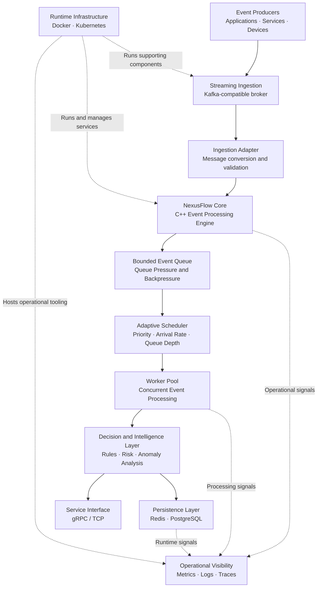
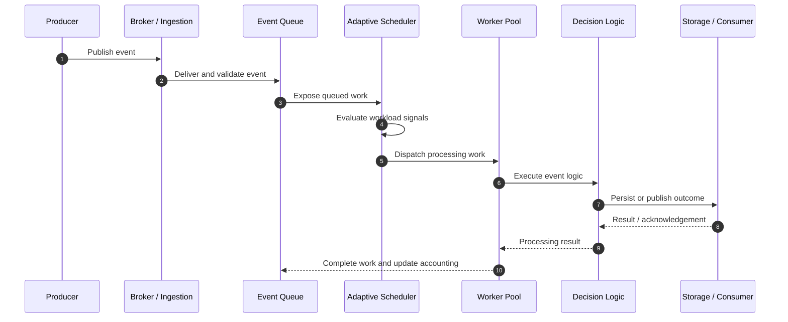

 <div align="center">

# NexusFlow

### Adaptive Real-Time Event Processing & Intelligent Decision Infrastructure

<p>
  <strong>High-performance systems engineering · Adaptive scheduling · Event-driven architecture · Real-time intelligence</strong>
</p>

<p>
  <a href="https://github.com/gavneet0030/NexusFlow"></a>
  <a href="https://isocpp.org/"></a>
  <a href="https://cmake.org/"></a>
  <a href="https://www.docker.com/"></a>
  <a href="https://kubernetes.io/"></a>
</p>

<p>
  <a href="#overview">Overview</a> ·
  <a href="#architecture">Architecture</a> ·
  <a href="#research-and-benchmarks">Research</a> ·
  <a href="#getting-started">Getting Started</a> ·
  <a href="#testing-and-validation">Testing</a> ·
  <a href="#roadmap">Roadmap</a>
</p>

**NexusFlow is an engineering project exploring how real-time event-processing systems can adapt their scheduling and processing behavior to changing workloads, queue pressure, event priorities, and latency requirements.**

</div>

---

## Table of Contents

- [Overview](#overview)
- [The Problem](#the-problem)
- [Project Objectives](#project-objectives)
- [Research and Engineering Approach](#research-and-engineering-approach)
- [Architecture](#architecture)
- [End-to-End Event Lifecycle](#end-to-end-event-lifecycle)
- [Adaptive Scheduling](#adaptive-scheduling)
- [Technology Stack](#technology-stack)
- [Benchmarking and Research Results](#research-and-benchmarks)
- [Real-World Data and Workload Design](#real-world-data-and-workload-design)
- [Reliability and Failure Handling](#reliability-and-failure-handling)
- [Observability and Deployment](#observability-and-deployment)
- [Industry Applications](#industry-applications)
- [Project Structure](#project-structure)
- [Getting Started](#getting-started)
- [Testing and Validation](#testing-and-validation)
- [Performance Evaluation Methodology](#performance-evaluation-methodology)
- [Security Considerations](#security-considerations)
- [Limitations and Engineering Trade-offs](#limitations-and-engineering-trade-offs)
- [Roadmap](#roadmap)
- [Contributing](#contributing)
- [License](#license)

---

## Overview

Modern applications continuously produce events: transactions, application logs, telemetry measurements, security alerts, user interactions, inventory updates, and operational signals.

Processing these events efficiently requires more than simply receiving messages and executing business logic. A robust system must also manage concurrency, queue growth, workload variability, event priorities, backpressure, processing latency, and failures.

**NexusFlow investigates these challenges through an adaptive event-processing architecture built around a C++ processing engine.**

The project combines systems-level programming with experimental performance evaluation. Rather than relying exclusively on theoretical claims, it uses controlled workload experiments, scheduler comparisons, event-integrity checks, and end-to-end latency measurements to study system behavior under different operating conditions.

### Core engineering themes

<table>
<thead>
<tr>
<th>Area</th>
<th>Objective</th>
<th>Engineering question</th>
</tr>
</thead>
<tbody>
<tr>
<td><strong>Event ingestion</strong></td>
<td>Accept and process incoming event streams.</td>
<td>How does the system behave as incoming load increases?</td>
</tr>
<tr>
<td><strong>Concurrency</strong></td>
<td>Coordinate processing workers and shared queues.</td>
<td>How can parallelism be used without compromising correctness?</td>
</tr>
<tr>
<td><strong>Adaptive scheduling</strong></td>
<td>Evaluate processing modes and workload signals.</td>
<td>When should the engine use individual, batched, or parallel processing?</td>
</tr>
<tr>
<td><strong>Backpressure</strong></td>
<td>Manage pressure when arrival rates exceed service capacity.</td>
<td>How does queue growth affect throughput and latency?</td>
</tr>
<tr>
<td><strong>Performance research</strong></td>
<td>Measure throughput, latency, and event integrity.</td>
<td>Which operating conditions produce acceptable performance?</td>
</tr>
<tr>
<td><strong>Operational engineering</strong></td>
<td>Explore containerization, service health, and deployment.</td>
<td>What additional validation is required for reliable deployment?</td>
</tr>
</tbody>
</table>

> **Project status:** NexusFlow is an evolving systems-engineering and research project. Reported benchmark experiments are historical measurements, not a guarantee of current performance. A fully production-validated deployment has not been established.

---

## The Problem

Traditional event-processing implementations often start with a fixed processing strategy. This may work for predictable workloads but can become inefficient when event arrival rates, processing costs, and priority distributions change.

### 1. Fixed processing strategies

A single-threaded pipeline is straightforward but may not use available processing capacity effectively. A parallel pipeline can improve throughput, but introduces coordination overhead and additional correctness requirements.

### 2. Queue saturation

When the event arrival rate exceeds the sustainable processing rate, queues grow. This can increase waiting time, consume memory, and eventually cause rejected or delayed events.

### 3. Throughput versus latency

A configuration that maximizes throughput may not provide acceptable tail latency. Systems must measure both rather than treating throughput as the only performance objective.

### 4. Workload variability

Real event streams are rarely perfectly uniform. Bursts, uneven event costs, and high-priority messages can change the most appropriate processing strategy.

### 5. Reliability and operational complexity

A functioning event-processing loop does not automatically establish reliable operation. Ingestion, persistence, health reporting, recovery, deployment configuration, and monitoring must also be validated.

### The central research question

**Can a workload-aware processing architecture make more informed scheduling decisions than a fixed processing strategy while preserving event integrity and making its performance measurable?**

NexusFlow approaches this question through implementation, controlled experiments, and explicit reporting of limitations.

---

## Project Objectives

The project is designed around the following objectives:

- Build a modular event-processing engine in modern C++.
- Explore bounded queues, worker coordination, and concurrent execution.
- Evaluate individual-event, micro-batch, and parallel processing modes.
- Incorporate workload signals such as queue depth, arrival rate, event priority, and latency budgets into scheduling decisions.
- Investigate backpressure and behavior near saturation.
- Measure throughput, percentile latency, queue waiting time, and event-processing integrity.
- Integrate event-streaming infrastructure such as Kafka-compatible brokers.
- Develop service interfaces and supporting storage integrations.
- Explore containerized deployment, service health checks, and operational observability.
- Maintain a clear distinction between implementation, measured evidence, and future engineering work.

The intended outcome is not merely a message consumer. It is an experimentally evaluated processing system whose behavior can be inspected, measured, and improved.

---

## Research and Engineering Approach

NexusFlow follows an iterative systems-engineering process.

<ol>
<li><strong>Define the workload.</strong> Specify offered event rates, event counts, priorities, and processing characteristics.</li>
<li><strong>Establish baseline modes.</strong> Evaluate different processing strategies under comparable conditions.</li>
<li><strong>Instrument the pipeline.</strong> Record throughput, end-to-end latency, queue waiting time, and event-integrity indicators.</li>
<li><strong>Run controlled experiments.</strong> Vary offered load and processing configuration while preserving the experimental parameters.</li>
<li><strong>Identify saturation behavior.</strong> Examine when increasing offered load stops producing proportional throughput gains.</li>
<li><strong>Analyze the results.</strong> Compare operating points, tail latency, and the limitations of the available repetitions.</li>
<li><strong>Validate correctness separately.</strong> Check event accounting and integration behavior independently of performance.</li>
<li><strong>Improve and repeat.</strong> Use measured bottlenecks to guide subsequent engineering changes.</li>
</ol>

### Design principles

- **Measurement before optimization:** performance claims should be tied to reproducible experiments.
- **Correctness before speed:** throughput is meaningful only when event accounting is trustworthy.
- **Explicit trade-offs:** batching, concurrency, queue capacity, and scheduling all introduce costs.
- **Modularity:** processing, ingestion, service interfaces, persistence, and deployment should remain independently inspectable.
- **Evidence-based reporting:** incomplete integrations and unverified behavior must remain visible.
- **Reproducibility:** workload parameters, run counts, and measurement definitions should accompany published results.

---

## Architecture

NexusFlow is organized around an event-processing core with supporting ingestion, decision-processing, storage, and operational components.

The architecture below represents the **intended system-level design**. Individual integrations must be evaluated against their current implementation and runtime tests; the diagram does not imply that every external component is already connected end to end.

### High-level architecture



### Architectural layers

<table>
<thead>
<tr>
<th>Layer</th>
<th>Responsibility</th>
<th>Key considerations</th>
</tr>
</thead>
<tbody>
<tr>
<td><strong>Event producers</strong></td>
<td>Generate transactions, telemetry, alerts, or application events.</td>
<td>Arrival-rate variability, event schemas, duplicate delivery.</td>
</tr>
<tr>
<td><strong>Ingestion adapter</strong></td>
<td>Receive messages and translate them into internal events.</td>
<td>Validation, acknowledgements, delivery semantics, error handling.</td>
</tr>
<tr>
<td><strong>Processing core</strong></td>
<td>Coordinate event processing and runtime execution.</td>
<td>Correctness, concurrency, lifecycle management.</td>
</tr>
<tr>
<td><strong>Queue and backpressure</strong></td>
<td>Buffer work and expose processing pressure.</td>
<td>Capacity, blocking behavior, overload policy.</td>
</tr>
<tr>
<td><strong>Scheduler and workers</strong></td>
<td>Select processing modes and execute work.</td>
<td>Scheduling overhead, fairness, worker utilization.</td>
</tr>
<tr>
<td><strong>Decision layer</strong></td>
<td>Apply business rules or intelligence models.</td>
<td>Decision quality, execution cost, explainability.</td>
</tr>
<tr>
<td><strong>Persistence and interfaces</strong></td>
<td>Support state storage and service access.</td>
<td>Durability, consistency, latency, error handling.</td>
</tr>
<tr>
<td><strong>Operations</strong></td>
<td>Support deployment, health checks, and system visibility.</td>
<td>Resource limits, security, observability, recovery.</td>
</tr>
</tbody>
</table>

### Integration boundaries

NexusFlow's wider design includes streaming ingestion, service interfaces, storage, and deployment tooling. A component's presence in the repository or deployment configuration is not, by itself, proof of successful runtime integration.

In particular, full pipeline validation must establish that an event can enter the system, be processed, produce the expected outcome, and be accounted for correctly at the final boundary.

---

## End-to-End Event Lifecycle

The intended event lifecycle is:



This sequence describes the target flow, not a claim that every arrow has already been proven in a single end-to-end deployment.

### Event-processing stages

1. **Ingestion:** receive a message from a producer or supported input adapter.
2. **Validation:** check the event representation and required fields.
3. **Queueing:** place accepted work into the processing pipeline.
4. **Scheduling:** choose an available processing mode according to configured signals and policy.
5. **Execution:** run event-processing logic through the relevant worker path.
6. **Decision:** evaluate the applicable processing or business logic.
7. **Output:** return, persist, or publish the result where that integration is enabled.
8. **Accounting:** record processing outcomes and validate event integrity.
9. **Observation:** measure processing latency, throughput, and queue behavior.

### Important distinction

**Message delivery, event acceptance, successful processing, and durable output are different events.** Reliable end-to-end validation must distinguish them rather than reporting a single counter as proof of the entire pipeline.

---

## Adaptive Scheduling

A central engineering theme of NexusFlow is the evaluation of different processing strategies under changing workload conditions.

### Processing modes

<table>
<thead>
<tr>
<th>Mode</th>
<th>Concept</th>
<th>Potential advantage</th>
<th>Trade-off</th>
</tr>
</thead>
<tbody>
<tr>
<td><strong>SINGLE</strong></td>
<td>Process events individually through a simpler execution path.</td>
<td>Low coordination complexity and a useful baseline.</td>
<td>May not exploit available parallel capacity.</td>
</tr>
<tr>
<td><strong>MICRO_BATCH</strong></td>
<td>Group multiple events before processing them.</td>
<td>May amortize dispatch or coordination overhead.</td>
<td>Batch formation can add waiting time; the current mode should not be assumed to provide vectorized execution.</td>
</tr>
<tr>
<td><strong>PARALLEL</strong></td>
<td>Distribute work across processing workers.</td>
<td>May improve throughput when work can be parallelized efficiently.</td>
<td>Introduces synchronization, scheduling, and contention costs.</td>
</tr>
</tbody>
</table>

### Workload signals

The scheduler design considers signals such as:

- **Event priority:** represent the relative importance of incoming work.
- **Arrival rate:** estimate the rate at which events enter the system.
- **Queue depth:** understand how much work is waiting.
- **Remaining latency budget:** account for the time available before a processing objective is exceeded.
- **CPU utilization:** consider available computational capacity.
- **Worker capacity:** account for the processing resources available to execute work.

The design uses these signals to evaluate scheduling behavior. The exact effectiveness of each signal depends on its implementation, sampling interval, thresholds, and the workload under test.

### Adaptive scheduling versus fixed scheduling

| Dimension | Fixed strategy | Adaptive strategy |
|---|---|---|
| Processing mode | Predetermined | Selected using workload signals and policy |
| Workload response | Requires external reconfiguration or remains unchanged | Can respond to measured conditions when implemented and enabled |
| Operational complexity | Usually simpler | Requires tuning, observability, and decision validation |
| Performance | Depends on the workload | Must be demonstrated experimentally |
| Predictability | Easier to reason about in simple configurations | Requires analysis of policy transitions and overhead |
| Correctness requirements | Must preserve event correctness | Must preserve event correctness across mode changes |

### Why this matters

Adaptive scheduling is not automatically faster. A policy can perform worse than a fixed strategy if its decisions are noisy, its thresholds are poorly calibrated, or its switching overhead exceeds the expected benefit.

The correct comparison is empirical: use equivalent event streams, controlled offered loads, repeated runs, integrity checks, and latency distributions.

---

## Technology Stack

The repository and system design use the following technologies and engineering areas. Their presence in the project should not be interpreted as proof that every integration is production-ready.

<table>
<thead>
<tr>
<th>Technology</th>
<th>Role</th>
</tr>
</thead>
<tbody>
<tr><td><strong>C++20</strong></td><td>Core event-processing and concurrency-oriented implementation.</td></tr>
<tr><td><strong>CMake</strong></td><td>Build configuration and native project organization.</td></tr>
<tr><td><strong>Threads and worker pools</strong></td><td>Concurrent execution and worker lifecycle management.</td></tr>
<tr><td><strong>Bounded queues</strong></td><td>Work buffering and queue-pressure management.</td></tr>
<tr><td><strong>Kafka-compatible streaming</strong></td><td>Event ingestion and asynchronous message processing through broker integrations.</td></tr>
<tr><td><strong>Redpanda</strong></td><td>Kafka-compatible broker for integration and local testing.</td></tr>
<tr><td><strong>gRPC / TCP</strong></td><td>Service communication and networking components.</td></tr>
<tr><td><strong>Redis / PostgreSQL</strong></td><td>Planned or evolving state and persistence integrations; verify runtime connectivity separately.</td></tr>
<tr><td><strong>Docker / Docker Compose</strong></td><td>Containerization and multi-service environment definitions.</td></tr>
<tr><td><strong>Kubernetes</strong></td><td>Deployment manifests, probes, service configuration, and scaling configuration.</td></tr>
<tr><td><strong>Prometheus / Grafana</strong></td><td>Intended metrics collection and visualization.</td></tr>
<tr><td><strong>OpenTelemetry / Tempo</strong></td><td>Intended instrumentation and trace-oriented observability.</td></tr>
<tr><td><strong>Python data tooling</strong></td><td>Benchmark analysis, experiment processing, and data-oriented evaluation.</td></tr>
<tr><td><strong>CTest and integration tests</strong></td><td>Native test execution and component validation.</td></tr>
</tbody>
</table>

---

## Research and Benchmarks

Performance evaluation is a central part of NexusFlow. The project has historical experiments covering saturation behavior, scheduler comparisons, and end-to-end latency.

**The figures below describe recorded experiments; they are not a freshly reproduced benchmark suite or a production service-level guarantee.**

### 1. Saturation sweep

<details open>
<summary><strong>Experiment configuration and reported observations</strong></summary>

- Reported runs: **27**
- Events per run: **10,000**
- Offered-load levels: **9**
- Repetitions per load level: **3**
- Total event workload: **270,000 events**
- Reported offered-load range: **10,000–50,000 events per second**
- Reported event-integrity validation: **27/27 runs passed**

| Measurement | Historical reported result |
|---|---:|
| Estimated saturation knee | Approximately 20,000 offered events/s |
| Recommended operating point in that experiment | Approximately 30,000 offered events/s |
| Highest measured mean throughput | 32,759.22 events/s |
| Run integrity validation | 27/27 passed |

**Interpretation:** The experiment suggests that sustainable throughput does not necessarily increase proportionally with offered load. The reported operating point is specific to the tested configuration, workload, and environment. It must not be generalized to other hardware or workloads without new measurements.

</details>

### 2. Scheduler comparison

<details>
<summary><strong>Comparison design and statistical limitations</strong></summary>

The historical scheduler comparison used:

- Four processing modes or configurations.
- Five offered-load levels.
- Three repetitions per configuration.
- 10,000 events per run.
- 60 total runs.
- A reported event-integrity pass rate of 100%.

The recorded analysis reported **zero statistically significant throughput comparisons out of 15 tested comparisons**.

This does not prove that the modes are equivalent. Three repetitions per configuration provide limited statistical power, particularly when run-to-run variation is substantial. More repetitions, confidence intervals, effect sizes, and controlled machine conditions are needed before making strong conclusions about scheduler superiority.

</details>

### 3. End-to-end latency experiment

<details>
<summary><strong>Workload and historical latency results</strong></summary>

The historical end-to-end latency experiment used the UCI Online Retail II dataset and the following offered-load levels:

| Parameter | Reported configuration |
|---|---|
| Events per run | 10,000 |
| Offered loads | 1,000; 10,000; 20,000; 30,000; 50,000 events/s |
| Repetitions per load | 3 |
| Total runs | 15 |
| Dataset | UCI Online Retail II |

At an offered load of 50,000 events/s, the report recorded:

| Metric | Historical reported result |
|---|---:|
| Achieved throughput | 22,525.33 events/s |
| End-to-end P50 latency | 72,485.8 µs |
| End-to-end P99 latency | 127,703 µs |
| Queue-wait fraction | 99.9712% |

These measurements indicate severe queue-wait dominance at the highest tested offered load in that experiment. The achieved throughput was substantially below the offered rate, consistent with a system operating beyond its sustainable processing capacity under those conditions.

The results should be interpreted as diagnostic evidence, not proof of a universal performance limit. The original environment, measurement implementation, event-processing path, and experiment artifacts must be reviewed before reproducing or extending the conclusions.

</details>

### Benchmark interpretation

The experiments highlight several important engineering lessons:

- Offered load and achieved throughput are not interchangeable.
- Queue waiting can dominate end-to-end latency near saturation.
- High throughput alone does not establish acceptable P99 latency.
- A successful event-integrity check is a separate result from a successful performance objective.
- Small repetition counts can make comparisons statistically inconclusive.
- Results must be associated with the machine, build configuration, workload, and experiment version that produced them.

### Benchmark methodology

A rigorous performance report should record:

- Hardware and operating system.
- Compiler and build configuration.
- Repository commit and configuration.
- Warm-up policy.
- Event count and event payload characteristics.
- Offered load and duration.
- Number of independent repetitions.
- Throughput definition and measurement interval.
- P50, P95, P99, and, where useful, P99.9 latency.
- Queue waiting time and processing time.
- Accepted, processed, failed, rejected, and persisted event counts.
- Confidence intervals or appropriate statistical comparisons.
- Raw measurements and scripts used to generate summary tables.

Raw benchmark artifacts should be published alongside the README when available. Summary figures without their measurement context are insufficient for independent verification.

---

## Real-World Data and Workload Design

### UCI Online Retail II

The historical end-to-end latency experiment used the **Online Retail II** dataset from the UCI Machine Learning Repository.

Dataset source: [UCI Machine Learning Repository — Online Retail II](https://archive.ics.uci.edu/dataset/502/online+retail+ii)

This dataset contains transactional retail records and is useful for constructing event-oriented workloads involving purchases, quantities, prices, customers, and timestamps.

The dataset is not inherently a live event stream. A benchmark harness can replay or transform historical records into events, but that process must be documented to distinguish the original data from the generated workload.

### Synthetic workloads

Synthetic events can supplement real data to control properties such as:

- Arrival rate and burstiness.
- Event size and payload distribution.
- Priority distribution.
- Processing-cost variation.
- Duplicate and malformed inputs.
- Queue pressure and overload behavior.

Synthetic data is useful for isolating system behavior, but it should not be presented as equivalent to real production traffic.

### Data integrity

A robust event experiment should account for each event across the full tested boundary.

For example:

- Events submitted.
- Events accepted by ingestion.
- Events queued.
- Events successfully processed.
- Events rejected or failed.
- Events persisted or delivered to the downstream consumer.

The exact invariant depends on the delivery model and retry behavior. Duplicates, retries, intentional rejections, and partial failures must be accounted for explicitly.

---

## Reliability and Failure Handling

Reliability is broader than a successful unit test or a running process. NexusFlow's engineering scope includes worker lifecycle management, bounded queues, streaming integration, health reporting, and deployment configuration.

### Reliability concerns

| Concern | Required behavior |
|---|---|
| Worker shutdown | Workers should stop safely and join without abandoning unaccounted work. |
| Queue draining | Shutdown behavior should define how queued work is handled. |
| Input overload | Backpressure or rejection behavior should be explicit and observable. |
| Broker interruption | Recovery and redelivery behavior must be tested against the configured delivery semantics. |
| Duplicate messages | Processing should define whether duplicates are acceptable, detected, or prevented. |
| Persistence failure | Failed writes must not be silently reported as durable success. |
| Service health | Health status should represent the actual conditions required for the service to operate. |
| Restart and recovery | State and event accounting should remain correct across restarts where required. |

### Delivery semantics

At-least-once delivery, at-most-once delivery, and exactly-once processing are different guarantees.

A broker acknowledgement or idempotent producer does not, by itself, establish exactly-once effects across an arbitrary processing pipeline and external database. Such guarantees require a carefully defined transaction, deduplication, or idempotency strategy and end-to-end failure testing.

NexusFlow should make delivery and persistence guarantees explicit for each supported integration rather than applying a universal label.

---

## Observability and Deployment

The repository includes deployment-oriented configuration for containerized services and Kubernetes. Operational readiness still depends on validating the actual running configuration.

### Intended operational signals

A useful observability model should include:

- Incoming and processed event rates.
- Queue depth and queue waiting time.
- Processing latency percentiles.
- Worker utilization and processing failures.
- Rejected events and retry counts.
- Broker and storage connectivity.
- Service health and restart counts.
- Resource usage and saturation signals.

### Deployment considerations

The Kubernetes configuration includes deployment, service, health-probe, and autoscaling definitions. The existence of these manifests does not establish that autoscaling, health semantics, or all dependencies work correctly in a live cluster.

Before describing a deployment as production-ready, validate:

1. Container image availability and version consistency.
2. Startup, readiness, and liveness behavior.
3. Service networking and dependency connectivity.
4. Resource requests, limits, and scaling signals.
5. Secret handling and runtime permissions.
6. Actual event processing through the deployed service.
7. Metrics and traces from the running workload.
8. Restart and failure-recovery behavior.

A successful container start is not equivalent to successful event processing.

---

## Industry Applications

NexusFlow's architecture is relevant to several event-driven domains. These are **potential application areas**, not claims of existing production deployments.

<details>
<summary><strong>Financial technology and transaction monitoring</strong></summary>

Potential applications include transaction-event ingestion, rule-based screening, risk-signal processing, and time-sensitive alert routing.

A real deployment would require domain-specific validation, durable event accounting, security controls, auditability, and appropriate regulatory compliance.

</details>

<details>
<summary><strong>Cybersecurity and threat monitoring</strong></summary>

Security telemetry, authentication events, and suspicious activity signals can arrive in bursts. Priority-aware processing and explicit overload behavior may help investigate how critical events should be handled during high-volume periods.

Detection accuracy and operational effectiveness would need separate evaluation against suitable security datasets.

</details>

<details>
<summary><strong>Retail and e-commerce</strong></summary>

Order events, inventory changes, checkout activity, and customer interactions can be processed as streams. The Online Retail II dataset provides a historical transactional-data starting point for workload experiments.

</details>

<details>
<summary><strong>IoT and industrial telemetry</strong></summary>

Sensor readings, machine-state updates, and operational alerts can produce continuous streams with varying rates and priorities. Queue management and tail-latency measurements are relevant to these workloads.

</details>

<details>
<summary><strong>Cloud infrastructure and observability</strong></summary>

Application logs, traces, metrics, and system events provide another workload category for studying ingestion, buffering, concurrency, and overload behavior.

</details>

<details>
<summary><strong>Logistics and supply-chain systems</strong></summary>

Shipment updates, inventory movements, and operational notifications can be modeled as event streams, with processing policies based on priority and latency requirements.

</details>

---

## Project Structure

The repository is organized around the processing core, integrations, testing, and deployment configuration. The exact contents may evolve as development continues.

```text
NexusFlow/
├── core/
│   ├── queue/
│   ├── workers/
│   └── processor/
├── api/
│   └── grpc/
├── deploy/
│   └── kubernetes/
├── docker/
├── tests/
│   ├── integration/
│   └── ...
├── docs/
├── CMakeLists.txt
├── CMakePresets.json
└── README.md
```

### Key areas

| Path | Responsibility |
|---|---|
| `core/` | Core processing logic and runtime components. |
| `core/queue/` | Queue implementation and work coordination. |
| `core/workers/` | Worker pool and lifecycle management. |
| `core/processor/` | Event-processing and pipeline logic. |
| `api/grpc/` | gRPC service implementation. |
| `tests/` | Unit, integration, and validation tests. |
| `deploy/kubernetes/` | Kubernetes deployment and service resources. |
| `docker/` | Container and multi-service environment configuration. |
| `docs/` | Architecture, design, and engineering documentation. |
| `CMakeLists.txt` | Main CMake build configuration. |
| `CMakePresets.json` | CMake preset definitions. |

This overview describes the known project organization, not an exhaustive file inventory.

---

## Getting Started

### Prerequisites

Before building the project, install and verify the tools required by the repository's current build configuration:

- Git.
- A C++20-compatible compiler.
- CMake.
- A compatible native build tool.
- Any third-party libraries required by the active CMake configuration.
- Docker, if using the containerized integration environment.

Kafka-compatible integration tests may also require a reachable Redpanda or Kafka broker. Other integrations may require additional services.

### 1. Clone the repository

```bash
git clone https://github.com/gavneet0030/NexusFlow.git
cd NexusFlow
```

### 2. Inspect the available CMake configuration

Review `CMakeLists.txt`, `CMakePresets.json`, and the documented dependencies before choosing a build preset. Presets can contain machine-specific paths, so do not assume a preset configured for one Windows installation will work on another machine or on Linux.

### 3. Configure and build

The exact configuration command depends on the compiler, operating system, and dependencies installed on the machine. Use the repository's supported configuration and avoid manually overriding compiler flags until the generated build configuration has been inspected.

**Current verification note:** A historical Linux CI run failed during CMake configuration before compilation and CTest could execute. Consequently, a clean, currently verified cross-platform build command cannot be guaranteed from that evidence alone.

Do not interpret the presence of CMake files as evidence that every platform configuration currently builds successfully.

### 4. Run tests after a successful build

Use the test targets generated by the configured build. CTest is the project's native test runner; integration tests may additionally require a broker, storage service, or other dependency.

A successful test command should be accompanied by the build configuration, test output, and the specific integration boundary that was exercised.

### 5. Run integration services

Use the repository's container configuration only after reviewing the environment variables, secret handling, port mappings, and required services. Never use example credentials or development defaults as production credentials.

---

## Testing and Validation

NexusFlow requires several complementary kinds of validation.

| Test category | What it establishes | What it does not establish |
|---|---|---|
| Unit tests | Behavior of an individual component. | Correctness of the full service. |
| Concurrency tests | Selected synchronization and worker behavior under tested conditions. | Absence of every race or deadlock. |
| Broker integration tests | Interaction with a configured streaming broker. | Correctness of every downstream integration. |
| gRPC health tests | Response of the health endpoint under tested conditions. | Successful event processing or persistence. |
| End-to-end tests | Behavior across the explicitly tested pipeline boundary. | Universal reliability under all failures. |
| Load tests | Performance under the tested workload and environment. | Performance on different hardware or workloads. |
| Deployment tests | Startup, networking, and behavior of a particular deployment. | Production readiness without broader operational validation. |

### Recommended validation gates

Before a release, verify:

- [ ] A clean build from a documented configuration.
- [ ] Unit and integration tests pass.
- [ ] No unexplained event-count discrepancies.
- [ ] Queue overload and shutdown behavior are tested.
- [ ] Broker interruptions and retries are tested where applicable.
- [ ] Health checks reflect meaningful service conditions.
- [ ] End-to-end output is validated, not just input acceptance.
- [ ] Performance measurements include tail latency and event integrity.
- [ ] Container and Kubernetes configurations are validated.
- [ ] Credentials are externalized and security settings are reviewed.
- [ ] The final report records the exact commit and environment.

---

## Performance Evaluation Methodology

To make benchmark claims reproducible, future experiment reports should use a consistent protocol.

### Controlled variables

Keep the following consistent across comparisons:

- Event payloads and event count.
- Machine, operating system, and compiler settings.
- Queue capacity and worker configuration.
- Broker and storage configuration.
- Warm-up period and measurement duration.
- Offered-load generation method.
- Event-integrity validation rules.

### Performance metrics

**Throughput**

\[
\text{Throughput} =
\frac{\text{Successfully processed events}}
{\text{Measurement duration}}
\]

The definition of successfully processed must be stated explicitly. Accepted events and durable outputs are not interchangeable.

**End-to-end latency**

\[
L_{\text{end-to-end}} =
t_{\text{completion}} - t_{\text{arrival}}
\]

Use a monotonic clock for duration measurements and define exactly where arrival and completion are recorded.

**Queue waiting time**

\[
L_{\text{queue}} =
t_{\text{processing start}} - t_{\text{enqueue}}
\]

This metric helps distinguish queue saturation from expensive event-processing logic.

### Statistical reporting

For meaningful scheduler comparisons:

- Run enough independent repetitions to characterize variability.
- Report median and tail latency, not only averages.
- Include confidence intervals where appropriate.
- Report effect sizes as well as statistical significance.
- Record outliers and explain any exclusion criteria.
- Separate tuning experiments from final evaluation.
- Preserve raw data so results can be independently recalculated.

---

## Security Considerations

Security must be evaluated at both the application and deployment layers.

### Credentials and secrets

- Keep database passwords, broker credentials, API keys, and tokens out of source control.
- Use environment-specific secret management for deployment.
- Replace placeholder secrets before running protected services.
- Rotate any real credential that may have been committed to a repository.
- Avoid publishing environment files or logs that expose credentials.

### Container security

- Run services as non-root users where practical.
- Use a read-only root filesystem where compatible with the application.
- Drop unnecessary Linux capabilities.
- Restrict writable directories.
- Set reasonable CPU and memory limits.
- Pin and review container image versions.
- Validate filesystem and network permissions.

### Application security

- Validate untrusted event payloads.
- Define message-size and queue-capacity limits.
- Apply authentication and authorization at exposed service boundaries.
- Avoid logging sensitive event data.
- Define timeout and failure behavior for external dependencies.
- Test malformed input and overload conditions.

These are security requirements and review criteria; their inclusion in this README is not a claim that every control has been audited or verified.

---

## Limitations and Engineering Trade-offs

NexusFlow is being developed as an evolving systems project. Several limitations must remain explicit.

### Performance results are environment-specific

Historical throughput and latency values apply to the tested configuration. They should not be used as universal capacity estimates or service-level commitments.

### Adaptive scheduling requires further evidence

The existence of multiple processing modes does not establish that adaptive decisions consistently outperform fixed strategies. The historical scheduler comparison did not demonstrate statistically significant throughput differences in the comparisons reported.

### Queue implementation characteristics matter

Concurrency and queue names do not establish lock-free behavior. Synchronization mechanisms, contention, and wake-up behavior must be examined in the implementation before making lock-free or wait-free claims.

### Integration is not the same as end-to-end correctness

A repository can contain broker adapters, service code, storage configuration, and Kubernetes manifests while still requiring additional validation of the complete running pipeline.

### Observability requires runtime evidence

Configuration files for metrics, tracing, or dashboards do not establish that meaningful telemetry is being collected, exported, and interpreted correctly.

### Deployment configuration needs environment-specific verification

Container images, CMake presets, secrets, resource limits, and Kubernetes settings may need adjustments for different machines and environments.

### Production readiness is a separate milestone

Before a production-readiness claim, the project requires a clean build, comprehensive integration and regression tests, reproducible performance results, security review, and runtime validation of the complete supported deployment.

---

## Roadmap

The roadmap focuses on strengthening correctness and reproducibility before making stronger performance or production claims.

<details open>
<summary><strong>1. Build and CI reliability</strong></summary>

- [ ] Resolve Linux CMake configuration failures.
- [ ] Verify clean builds on supported platforms.
- [ ] Make build configuration portable.
- [ ] Run automated tests on the supported CI matrix.
- [ ] Publish test results for the exact release commit.

</details>

<details>
<summary><strong>2. Processing correctness</strong></summary>

- [ ] Verify timestamp and event-metadata handling.
- [ ] Strengthen event accounting across ingestion and processing.
- [ ] Test worker shutdown and queue draining under load.
- [ ] Exercise overload, malformed inputs, and failure paths.
- [ ] Define duplicate and retry semantics.

</details>

<details>
<summary><strong>3. Streaming and storage integration</strong></summary>

- [ ] Validate broker ingestion through actual downstream processing.
- [ ] Verify acknowledgements and consumer recovery.
- [ ] Validate Redis and PostgreSQL runtime connectivity.
- [ ] Test persistence failures and restart behavior.
- [ ] Establish end-to-end event-integrity invariants.

</details>

<details>
<summary><strong>4. Scheduler research</strong></summary>

- [ ] Increase independent repetitions for scheduler comparisons.
- [ ] Publish raw benchmark data and experiment metadata.
- [ ] Report confidence intervals and effect sizes.
- [ ] Evaluate tail latency under increasing offered load.
- [ ] Compare queueing and processing costs separately.
- [ ] Reproduce saturation experiments on documented hardware.

</details>

<details>
<summary><strong>5. Operational readiness</strong></summary>

- [ ] Validate health probes against real service dependencies.
- [ ] Verify that smoke tests exercise actual service behavior.
- [ ] Validate autoscaling metrics and resource limits.
- [ ] Verify metrics and traces from a running deployment.
- [ ] Remove insecure defaults and externalize secrets.
- [ ] Complete deployment and security regression checks.

</details>

<details>
<summary><strong>6. Documentation and release</strong></summary>

- [ ] Document supported build environments.
- [ ] Publish reproducible setup and test instructions.
- [ ] Attach benchmark artifacts and analysis scripts.
- [ ] Record limitations and known issues for each release.
- [ ] Produce a demonstration of the verified end-to-end path.
- [ ] Publish a release only after the corresponding validation gates pass.

</details>

---

## Contributing

Contributions that improve correctness, reproducibility, performance analysis, or operational reliability are welcome.

### Contribution guidelines

1. Open an issue describing the problem, proposed change, or experiment.
2. Keep changes focused and explain their engineering motivation.
3. Add or update tests for behavioral changes.
4. Include benchmark methodology when claiming performance improvements.
5. Document any new dependencies and configuration requirements.
6. Never include credentials, tokens, or private production data.
7. Report unverified behavior honestly and provide reproduction steps.

For performance-related contributions, include the workload, baseline, hardware, build configuration, number of repetitions, latency metrics, and event-integrity results.

---

## License

Before reusing or redistributing NexusFlow, check the repository for an explicit `LICENSE` file. If no license has been published, permission to use, modify, or redistribute the project should not be assumed.

---

<div align="center">

### Building systems that adapt to real workloads.

**NexusFlow — Adaptive processing, measurable performance, and evidence-driven engineering.**

Repository: [github.com/gavneet0030/NexusFlow](https://github.com/gavneet0030/NexusFlow)

</div>
